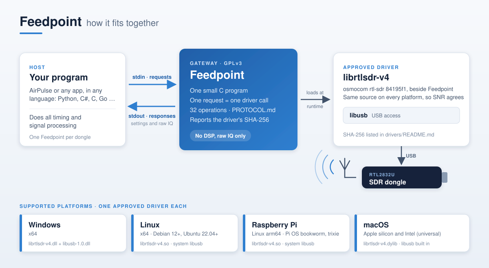

# Feedpoint - A Universal SDR Gateway

Open-source RTL2832U dongle server: tune, read, return raw IQ.

Feedpoint is a small standalone program that owns one RTL2832U dongle. A host
program starts it, sends requests on its standard input and reads responses
from its standard output. Each request is one librtlsdr call: list and open
dongles, tune (sample rate, frequency, bandwidth, gain, frequency correction,
direct sampling, offset tuning, crystal frequency), switch the bias tee, read
back the settings, and read samples. Feedpoint does no signal processing; all
timing and DSP belong to the host.

Any program that can start a process and use its pipes can use Feedpoint. The
protocol is documented in [PROTOCOL.md](PROTOCOL.md).



## Example

A minimal Python host: open the first dongle, tune to 147.600 MHz and read one
block of raw IQ. For a fuller example that uses the 1.1 operations (gain list,
reading settings back, IQ level), see [examples/](examples).

```python
import struct, subprocess
from enum import IntEnum

class Op(IntEnum):              # matches PROTOCOL.md
    UNASSIGNED = 0
    HELLO = 1
    LIST = 2
    OPEN = 3
    CLOSE = 4
    SET_SAMPLE_RATE = 5
    SET_CENTER_FREQUENCY = 6
    SET_TUNER_BANDWIDTH = 7
    SET_AGC_MODE = 8
    SET_TUNER_GAIN_MODE = 9
    SET_TUNER_GAIN = 10
    RESET_BUFFER = 11
    READ_SYNC = 12
    GET_VERSION = 13
    GET_TUNER_GAINS = 14
    GET_TUNER_GAIN = 15
    GET_SAMPLE_RATE = 16
    GET_CENTER_FREQUENCY = 17
    GET_TUNER_TYPE = 18
    SET_FREQUENCY_CORRECTION = 19
    GET_FREQUENCY_CORRECTION = 20
    SET_BIAS_TEE = 21
    SET_BIAS_TEE_GPIO = 22
    SET_DIRECT_SAMPLING = 23
    GET_DIRECT_SAMPLING = 24
    SET_OFFSET_TUNING = 25
    GET_OFFSET_TUNING = 26
    SET_XTAL_FREQUENCY = 27
    GET_XTAL_FREQUENCY = 28
    SET_TUNER_IF_GAIN = 29
    GET_INDEX_BY_SERIAL = 30
    GET_DEVICE_NAME = 31
    GET_USB_STRINGS = 32

fp = subprocess.Popen(["./feedpoint"], stdin=subprocess.PIPE, stdout=subprocess.PIPE)

def call(op, value=None):
    arg = b"" if value is None else struct.pack("<I", value)
    fp.stdin.write(struct.pack("<BI", op, len(arg)) + arg)
    fp.stdin.flush()
    status, length = struct.unpack("<iI", fp.stdout.read(8))
    if status != 0:
        raise RuntimeError(f"{op.name} failed: {status}")
    return fp.stdout.read(length)

call(Op.OPEN, 0)                            # device 0
call(Op.SET_SAMPLE_RATE, 900_001)           # lowest rate in librtlsdr's 0.9–3.2 MS/s range
call(Op.SET_CENTER_FREQUENCY, 147_600_000)  # 147.600 MHz
call(Op.SET_TUNER_GAIN_MODE, 0)             # auto gain
call(Op.RESET_BUFFER)
iq = call(Op.READ_SYNC, 16_384)             # bytes, multiple of 512

for i in range(0, 10, 2):                   # unsigned 8-bit, centered on 127.5
    print(iq[i] - 127.5, iq[i + 1] - 127.5)

fp.stdin.close()                            # Feedpoint closes the dongle and exits
```

## Drivers

Feedpoint loads exactly one approved driver, `librtlsdr-v4.dll` / `.so` /
`.dylib`, from beside the Feedpoint executable. It never searches the
operating system's library path, so a node runs the proven driver or reports
plainly that it is missing. `RTLSDR_LIBRARY_PATH` overrides the location for
testing. The Hello response includes the driver's SHA-256 so the host can
confirm it is an approved build.

The approved drivers, their exact source code, licenses and attribution are in
[`drivers/`](drivers). On Windows, `libusb-1.0.dll` must sit beside the driver;
on Linux the driver uses the system libusb-1.0.

## Building

Open the folder in Visual Studio (File > Open > Folder) with the "Desktop
development with C++" workload, or use CMake directly. GitHub Actions builds
Windows x64, Linux x64, Linux arm64 and macOS (universal) on every push; the
builds download from the workflow run's page.

Tests run against a real dongle from Visual Studio's Test Explorer or VS
Code's Testing panel; see [tests/README.md](tests/README.md).

## Roadmap and working on Feedpoint

Feedpoint 1.0.0 covers what AirPulse needs. The rest of the tuner controls and
gapless streaming are planned in [ROADMAP.md](ROADMAP.md). To propose or add
an operation, see [CONTRIBUTING.md](CONTRIBUTING.md).

## Credits

Feedpoint builds on the work of:

- [osmocom rtl-sdr](https://gitea.osmocom.org/sdr/rtl-sdr) — librtlsdr
  (GPL-2.0-or-later), including the RTL-SDR Blog team's V4 support.
- [libusb](https://libusb.info) — USB access (LGPL-2.1-or-later).

Full attribution and license texts for the bundled drivers are in
[`drivers/README.md`](drivers/README.md).

Feedpoint is used by [AirPulse](https://feedlinelabs.com) from Feedline Labs.

## License

Copyright (C) 2026 Feedline Labs.

Feedpoint is free software: you can redistribute it and/or modify it under the
terms of the GNU General Public License as published by the Free Software
Foundation, either version 3 of the License, or (at your option) any later
version. See [LICENSE](LICENSE).

"RTL-SDR" is a trademark of RTL-SDR Blog Ltd. Feedpoint is not affiliated with
RTL-SDR Blog Ltd or Realtek.
